La fotografía me enseñó a mirar. El desarrollo, a construir.
Trabajo sin prisa, a propósito: elijo un encuadre, escribo una línea de código,
y ambos nacen de la misma intención.

DESARROLLO WEB · FOTOGRAFÍA · CONTENIDO VISUAL — © 2026 PIXEL STUDIO

